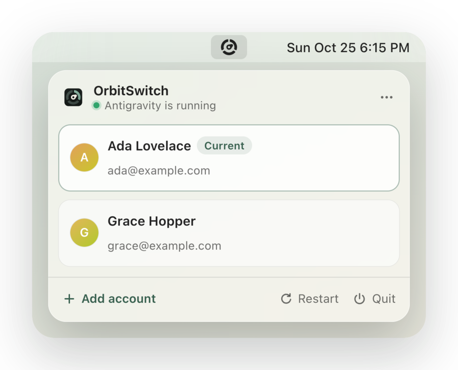

# OrbitSwitch for Antigravity Desktop

[简体中文](README.zh-CN.md) · [Download](https://github.com/maycomayko/orbitswitch/releases/latest) · [Build from source](docs/release.md) · [Compatibility](docs/status.md)

A lightweight menu bar app for switching between your Google accounts in Antigravity Desktop.

<picture><source media="(prefers-color-scheme: dark)" srcset="assets/screenshots/hero-dark.png"></picture>

- **Switch accounts.** OrbitSwitch detects the current sign-in. Add a second account in your browser, then select it to switch and reopen the desktop app.
- **Optional plans and quota.** Off by default. **⋯ → Show plans and quota** explains the account risk and asks for confirmation before it starts checking via internal Google APIs.
- **Set the network route.** In **⋯ → Network settings**, use system networking or a local HTTP proxy. Test the connection before saving.

On macOS with Antigravity 2.35.2, switching between Free and Pro preserved local projects, and testing confirmed that existing conversations could continue and installed plugins could be used. Antigravity showed an onboarding prompt in both directions. Click **Continue** to return to the workspace. [Verification details](docs/status.md#installed-client-verification-macos)

Release downloads cover macOS 26+ on Apple Silicon and Windows 10/11 x64. Windows account switching on a real Antigravity installation is unverified. See [the verification record](docs/status.md) for Antigravity version coverage.

[MIT](LICENSE) · A desktop-only fork of [OrbitSwitch](https://github.com/shengyy/orbitswitch).
