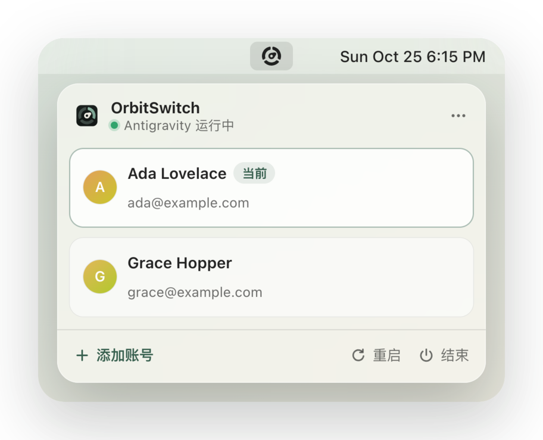

# OrbitSwitch · Antigravity 桌面版

[English](README.md) · [下载](https://github.com/maycomayko/orbitswitch/releases/latest) · [从源码构建](docs/release.md) · [兼容与验证记录](docs/status.md)

一个轻量菜单栏工具，用来手动切换 Antigravity 桌面端的 Google 账号。

<picture><source media="(prefers-color-scheme: dark)" srcset="assets/screenshots/hero-zh-dark.png"></picture>

- **切换账号。** 自动识别当前登录。在浏览器授权第二个账号后，点账号卡片即可切换并重新打开桌面端。
- **按需查看套餐和额度。** 默认关闭。通过 **⋯ → 显示套餐和额度** 阅读并确认账号风险后，才会调用 Google 内部接口查询。
- **设置网络。** 从 **··· → 网络设置** 选择跟随系统网络或使用本机 HTTP 代理，保存前可以测试连接。

在 macOS 上实测 Antigravity 2.35.2，Free 和 Pro 双向切换后，本机项目仍在，旧会话可以继续聊，已安装的插件可以使用。两个方向都出现了 Antigravity 的引导弹窗，点击「继续」即可回到工作区。[验证详情](docs/status.md#installed-client-verification-macos)

Release 提供 Apple Silicon 版 macOS 26+ 和 Windows 10/11 x64 的下载。Windows 实机切号尚待验证。Antigravity 各版本的验证范围见[验证记录](docs/status.md)。

[MIT](LICENSE) · 基于 [OrbitSwitch](https://github.com/shengyy/orbitswitch) 的桌面专用 fork。
