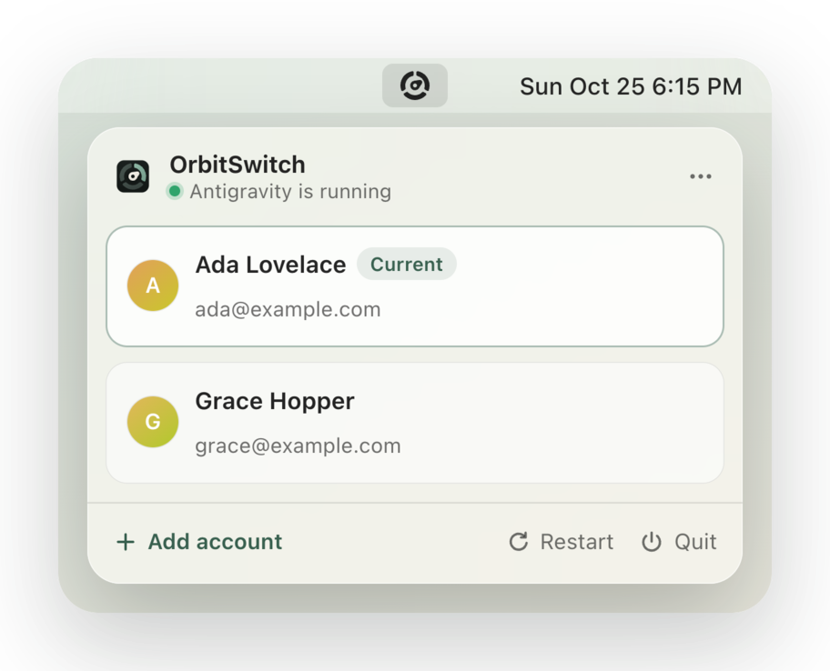

# OrbitSwitch · Antigravity 专用版

[English](README.md) · [兼容与验证记录](docs/status.md)

在 macOS 菜单栏或 Windows 系统托盘手动切换自己的 Antigravity 订阅账号，查看当前账号、
剩余额度及重置时间。工具管理 Antigravity 桌面端。

<picture><source media="(prefers-color-scheme: dark)" srcset="assets/screenshots/hero-dark.png"></picture>

## 使用

1. 从菜单栏或系统托盘打开 OrbitSwitch。它会识别 Antigravity 当前登录的账号。
2. 选择**添加账号**，在浏览器中授权另一个 Google 账号。
3. 选择账号并确认切换。OrbitSwitch 会验证目标账号、关闭相关进程、写入并回读凭据，再打开 Antigravity。

额度来自 Antigravity 订阅，其中可能包含 Antigravity 自己提供的 Claude/GPT 模型额度池。
应用不会连接这些模型的独立客户端或订阅服务。

旧版已保存的 Antigravity 账号可以继续使用。升级时手动换成本 fork 的新构建。
参见[构建说明](docs/release.md)和[凭据存储说明](SECURITY.md)。

在 **··· → 网络设置** 中可以选择跟随系统网络，或填写本机 HTTP 代理端口。
可先测试能否连接 Google，保存后立即生效，只影响 OrbitSwitch。

MIT。基于[上游 OrbitSwitch](https://github.com/shengyy/orbitswitch)，与 Google 无隶属关系。
